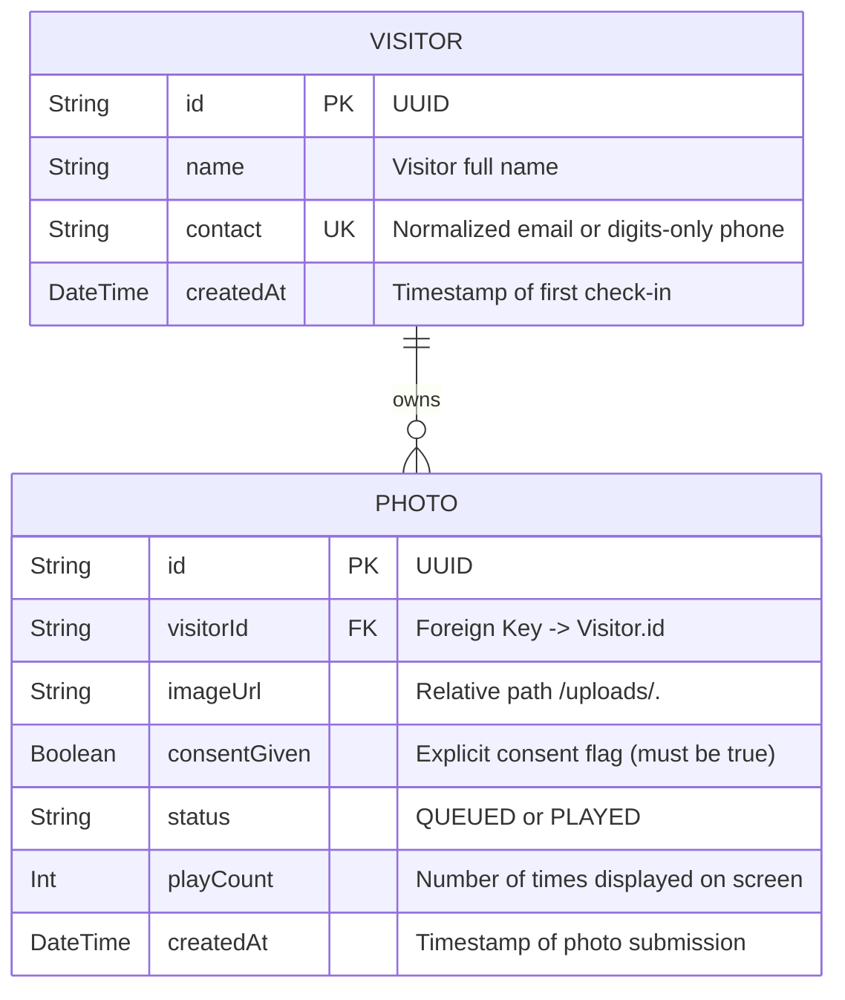
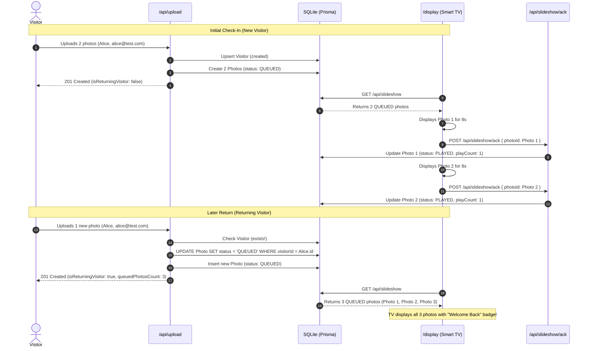

# System Architecture & Technical Specifications

## 1. Overview & System Rationale

The **Visitor Photo Slideshow** is a responsive, privacy-conscious full-stack web application designed for exhibitions, art galleries, museums, and experiential events. It provides a dual-interface experience:

1. **Visitor Check-In & Privacy Portal (`/`)**: A mobile-friendly kiosk where guests can check in with their name, contact (email or phone), grant explicit public display consent, upload 1–3 photos, and manage or delete their media at any time.
2. **Smart TV / Museum Exhibition Display (`/display`)**: A full-viewport, zero-scroll presentation that continuously showcases photos on a dark espresso gallery wall with an ambient blurred backdrop, authentic exhibition plaques, and real-time queue polling.

### 1.1 Technology Stack & Decision Matrix

| Layer | Chosen Technology | Architectural Rationale | Alternatives Considered & Rejected |
| :--- | :--- | :--- | :--- |
| **Framework** | **Next.js 14+ (App Router)** | Full-stack unified framework eliminating CORS and separate backend hosting; server route handlers (`src/app/api/*`) for database queries; optimized static and dynamic page rendering. | **Vite + Express**: Required running two separate processes, managing proxy configurations, and doubled deployment overhead. |
| **Language** | **TypeScript 5+** | Compile-time type safety across database entities, API request/response payloads, and UI components; prevents runtime typos and structural bugs. | **JavaScript**: Lacks static typing; elevated risk of null-reference bugs and schema mismatch in multi-field form handling. |
| **Styling** | **Tailwind CSS v4** | Rapid utility-first styling powering the customized **Warm Editorial Gallery Theme** (`#FAF6F0` cream, `#2C221E` espresso, `#B85A3A` terracotta) with zero runtime CSS-in-JS performance penalty. | **CSS Modules / Styled Components**: Slower development velocity; higher boilerplate for responsive TV and mobile layouts. |
| **ORM & Database** | **Prisma ORM + PostgreSQL (Neon)** | Cloud-native serverless PostgreSQL powering concurrent, transaction-safe queries and seamless Vercel deployment; strict schema typing via `@prisma/client`. | **Raw SQL / SQLite in Production**: Ephemeral filesystem on Vercel wipes local SQLite databases on every serverless function re-invocation. |
| **File Storage** | **Cloudinary CDN (`visitor-slideshow`)** | Production-ready persistent cloud media storage with global CDN delivery, automated format optimization, and safe asset deletion via Cloudinary Admin SDK. Includes local fallback if credentials are unset. | **Local disk on Vercel**: Vercel's serverless environment has a read-only/ephemeral filesystem where local file writes are discarded across invocations. |

---

## 2. Complete Data Model

The database schema is defined in [`prisma/schema.prisma`](file:///c:/Users/ASUS/Desktop/ass1/prisma/schema.prisma) and operates over PostgreSQL (e.g. Neon Serverless Postgres).

### 2.1 Entity Relationship Diagram



### 2.2 Model Specifications

#### Table: `Visitor`
Represents an individual guest who registers at the exhibition.
- `id` (`String`, Primary Key): Generated using `uuid()`.
- `name` (`String`): The visitor's display name shown on the TV exhibition plaque.
- `contact` (`String`, Unique): Normalized contact string (trimmed and lowercased for email, non-digits stripped for phone). Serves as the identity anchor to detect returning visitors and authenticate privacy management requests without requiring password-based accounts.
- `createdAt` (`DateTime`): Defaults to `now()`. Used to calculate if a photo upload belongs to a returning visitor session.
- `photos` (`Photo[]`): One-to-many relation to `Photo`.

#### Table: `Photo`
Represents an individual photograph uploaded by a visitor.
- `id` (`String`, Primary Key): Generated using `uuid()`.
- `visitorId` (`String`, Foreign Key): Links to `Visitor.id`. Configured with `onDelete: Cascade` so deleting a visitor automatically purges all their photo records.
- `imageUrl` (`String`): Stored relative URL (e.g., `/uploads/476a1bdb-dd7c-418b-a899-5321cee01be1.jpg`).
- `consentGiven` (`Boolean`): Confirms that the visitor checked the explicit consent checkbox prior to submission.
- `status` (`String`): Either `"QUEUED"` (waiting to be displayed) or `"PLAYED"` (already presented on the TV display). Defaults to `"QUEUED"`.
- `playCount` (`Int`): Incremented each time the TV display completes an 8-second slide presentation and calls the acknowledgment endpoint. Defaults to `0`.
- `createdAt` (`DateTime`): Defaults to `now()`. Used for FIFO queue sequencing.

---

## 3. System Architecture & Workflows

### 3.1 End-to-End Upload-to-Slideshow Flow

```mermaid
flowchart TD
    subgraph Client ["Visitor Device (Mobile / Kiosk)"]
        A[User fills Name, Contact, & selects 1-3 Photos] --> B{Client-side Pre-validation}
        B -- "Invalid (type/size >5MB/count >3)" --> C[Show Inline Warning]
        B -- "Valid & Consent Checked" --> D[POST /api/upload (multipart/form-data)]
    end

    subgraph Server ["Next.js App Server"]
        D --> E{Server-side Validation}
        E -- "Failed validation" --> F[Return 400 Bad Request]
        E -- "Passed" --> G[Normalize Contact email or phone]
        G --> H[Check if Visitor exists in SQLite]
        H -- "Returning Visitor" --> I[Mark isReturningVisitor = true]
        I --> J["Reset older photos' status to QUEUED"]
        H -- "New Visitor" --> K[Create Visitor record]
        J --> L["Save files to public/uploads/ as UUID.ext"]
        K --> L
        L --> M[Insert Photo records with status QUEUED]
        M --> N["Return 201 JSON (isReturningVisitor, count)"]
    end

    subgraph Display ["Smart TV Exhibition Display (/display)"]
        O["Poll GET /api/slideshow every 5s"] --> P["Fetch QUEUED photos (FIFO: createdAt asc)"]
        P --> Q["Backfill with PLAYED photos (createdAt desc)"]
        Q --> R["Render Framed Canvas & Glass Plaque"]
        R --> S["Wait 8s slide duration (countdown progress bar)"]
        S --> T["POST /api/slideshow/ack { photoId }"]
        T --> U["Prisma marks photo PLAYED & increments playCount"]
        U --> V["Advance to next slide smoothly"]
    end

    N -.-> Display
```

### 3.2 Returning Visitor Lifecycle & Playback Loop



---

## 4. Concurrency, Integrity & Security Handling

### 4.1 Cloud-Native Storage & Collision-Free Uploads
- **Cloudinary Media Pipeline**: Uploaded image buffers are streamed directly to Cloudinary under the `visitor-slideshow` folder. Cloudinary generates globally unique public IDs and serves images via secure HTTPS CDN URLs (`https://res.cloudinary.com/...`).
- **Zero Local Disk Dependency for Vercel**: Eliminates the serverless ephemeral filesystem limitation where local `/public/uploads` files are lost upon cold starts.
- **Graceful Local Fallback**: If Cloudinary credentials are not provided in development, the system falls back to saving files in `public/uploads/` with `crypto.randomUUID()` filenames.

### 4.2 Strict Multi-Tier File Validation
1. **Client-Side Validation**:
   - File count limit: strictly 1 to 3 files.
   - Size limit: 5MB maximum per file.
   - MIME types: strictly `image/jpeg`, `image/png`, and `image/webp`.
2. **Server-Side Validation**:
   - The route handler [`src/app/api/upload/route.ts`](file:///c:/Users/ASUS/Desktop/ass1/src/app/api/upload/route.ts) validates file entries independently from the client, checking `file.size` against `5 * 1024 * 1024` and `file.type` against an allowed Set.
   - Invalid uploads immediately terminate with an HTTP `400 Bad Request` and descriptive JSON errors without writing unverified bytes to disk.

### 4.3 Safe Deletion & Path Traversal Protection
In [`src/app/api/visitor/photos/route.ts`](file:///c:/Users/ASUS/Desktop/ass1/src/app/api/visitor/photos/route.ts), when a visitor requests photo deletion:
- `path.basename(imageUrl)` extracts only the filename.
- `path.resolve(uploadsDir, filename)` constructs the absolute target path.
- The path is validated: `resolvedPath.startsWith(uploadsDir)`. Any attempt to supply directory traversal segments (e.g., `../../etc/passwd` or `..\..\Windows`) is caught and rejected immediately.

### 4.4 Queue Ordering & Fair Exhibition Display
- Newly uploaded and re-queued photos (`status: "QUEUED"`) are sorted by `createdAt asc`. This guarantees a **FIFO (First-In, First-Out)** order so recent submissions are displayed in the order visitors checked in.
- Once the active queue is exhausted, the endpoint backfills the remaining slots with `status: "PLAYED"` photos sorted by `createdAt desc`. This creates a seamless continuous loop so the gallery display never goes blank.
